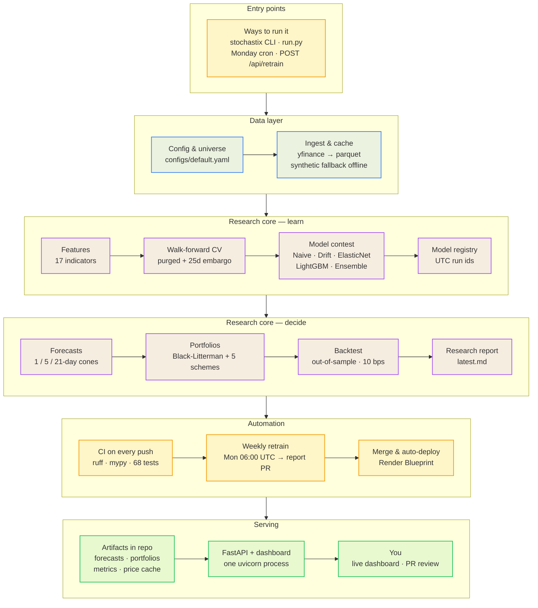

<p align="center">
  
</p>

<h3 align="center">AI-powered stock forecasting & portfolio optimization platform</h3>

<p align="center">
  Forecasts prices at multiple horizons · Optimizes portfolios with Black-Litterman · Backtests honestly · Serves via a real-time API & terminal-style dashboard
</p>

<p align="center">
  <a href="#quickstart">Quickstart</a> ·
  <a href="#features">Features</a> ·
  <a href="#api">API</a> ·
  <a href="#deployment">Deployment</a> ·
  <a href="#architecture">Architecture</a>
</p>

<p align="center">
  
  
  
  
  
</p>

---

## What is this?

Stochastix is a full-stack ML system that takes raw stock data and produces:

1. **Price forecasts** at 1-day, 5-day, and 21-day horizons using walk-forward validated models
2. **Portfolio allocations** via Black-Litterman optimization, risk parity, HRP, and more
3. **Out-of-sample backtests** with transaction costs and realistic rebalancing
4. **A real-time REST API** with a terminal-style web dashboard

It ships with 10 US equities, trains in under a minute on synthetic data, and works completely offline for demos.

---

## Quickstart

```bash
# Clone and install
git clone https://github.com/YOUR_USERNAME/stochastix.git
cd stochastix
pip install -e ".[dev]"

# Run the full pipeline (auto-falls back to synthetic data if offline)
python run.py

# Launch the web dashboard
python run.py serve          # http://127.0.0.1:8000
```

That's it. The pipeline ingests data, trains models, forecasts prices, optimizes portfolios, runs backtests, and generates a research report — all in one command.

### Offline demo (no internet needed)

```bash
python run.py quick          # ~30s demo on synthetic data
# or
stochastix pipeline --synthetic
```

### Individual commands

```bash
stochastix ingest            # download OHLCV → data/cache/
stochastix train             # walk-forward training → artifacts/models/
stochastix forecast          # price predictions → artifacts/forecasts/
stochastix optimize          # portfolio allocations → artifacts/portfolios/
stochastix backtest          # out-of-sample backtest → artifacts/backtest/
stochastix report            # markdown report → artifacts/reports/
stochastix serve             # REST API + web dashboard on :8000
```

---

## Features

### Data Pipeline
- **yfinance ingestion** with retry logic, exponential backoff, and parquet caching
- **OHLCV validation** — checks for gaps, non-positive prices, and non-finite values
- **Synthetic generator** — seeded GBM with AR(1) momentum and regime switching for offline testing

### Feature Engineering (17 indicators)
Multi-scale returns, rolling volatility, RSI, MACD, Bollinger %B, ATR, volume z-score, moving average gaps, cross-sectional relative strength — all computed per ticker-day.

### Model Selection
| Model | Type |
|---|---|
| Naive | Previous-day return |
| Drift | Historical mean |
| ElasticNet | Regularized linear |
| LightGBM | Gradient boosted trees |
| Ensemble | Inverse-RMSE weighted blend |

Best model selected per horizon via purged walk-forward cross-validation.

### Portfolio Optimization
- **Black-Litterman** — blends market equilibrium with model forecasts as absolute views
- **Max-Sharpe** / **Min-Variance** / **Risk Parity** / **Equal Weight**
- **HRP** (Hierarchical Risk Parity) — distance-based clustering + quasi-diagonal bisection
- Ledoit-Wolf shrunk covariance, long-only with configurable max weight

### Backtesting
- Rebalances strictly on out-of-sample predictions
- Transaction costs in basis points per turnover
- Equity curves, drawdown analysis, Sharpe, CAGR, Calmar ratio

### Web Dashboard
- Terminal-inspired dark UI with JetBrains Mono typography
- Real-time charts (Chart.js) for normalized performance, forecast cones, allocation donuts, correlation heatmaps
- Fully responsive — works on desktop, tablet, and mobile
- Hamburger nav on mobile with slide-out sidebar

### API
- `GET /api/health` — service status and latest model run
- `GET /api/tickers` — universe configuration
- `GET /api/forecast/{horizon}` — price forecasts for 1d, 5d, or 21d
- `POST /api/portfolio` — portfolio optimization with configurable capital and schemes
- `GET /api/prices?days=252` — historical close prices
- `GET /api/correlations?days=120` — correlation matrix
- `POST /api/retrain` — trigger background retraining (API key protected)
- Interactive docs at `/docs` (Swagger UI)

---

## Architecture

One pipeline from market data to the live dashboard — data layer in blue, research core in purple, serving in green, automation in amber:



### Project layout

```
src/stockforge/
├── data/          PricePanel · yfinance ingestion · parquet cache · validation · synthetic
├── features/      Technical indicators · supervised dataset builder
├── models/        Baselines · ElasticNet · LightGBM · ensemble · metrics
│                  Walk-forward CV (purged + embargo) · filesystem registry
├── portfolio/     Ledoit-Wolf covariance · Black-Litterman · optimizers · HRP · risk analytics
├── backtest/      Cost-aware walk-forward backtesting engine
├── api/           FastAPI app + Pydantic schemas + static file serving
├── dashboard/     Streamlit research lab (alternative to web dashboard)
├── reporting/     Markdown research report generation
├── cli.py         Typer CLI — the command center
└── training.py    Orchestration: CV → selection → refit → registry
frontend/          Terminal-style web dashboard (HTML/CSS/JS + Chart.js)
tests/             68 tests including leakage checks and full-pipeline integration
```

---

## Configuration

All settings live in [`configs/default.yaml`](configs/default.yaml). Environment variables override any value:

| Variable | Purpose |
|---|---|
| `STOCKFORGE_LOG_LEVEL` | Logging verbosity (DEBUG, INFO, WARNING) |
| `STOCKFORGE_ARTIFACTS_DIR` | Where models, forecasts, and reports are stored |
| `STOCKFORGE_DATA_CACHE_DIR` | Where downloaded price data is cached |
| `STOCKFORGE_API_KEY` | Protects the `/api/retrain` endpoint |

<details>
<summary>Example config</summary>

```yaml
universe:
  tickers: [AAPL, MSFT, NVDA, AMZN, GOOGL, META, TSLA, JPM, XOM, SPY]
  benchmark: SPY

features:
  horizons: [1, 5, 21]
  warmup_days: 210

cv:
  n_splits: 5
  min_train_days: 504
  embargo_days: 25

portfolio:
  max_weight: 0.35
  delta: 2.5
  tau: 0.05
  blend_model_weight: 0.5
  risk_free_rate: 0.04
  lookback_days: 126

backtest:
  rebalance_days: 21
  cost_bps: 10.0
```

</details>

---

## Deployment

### Render (recommended)

A single Render **Web Service** handles everything — the FastAPI backend serves the frontend static files.

1. Push your repo to GitHub
2. Go to [render.com](https://render.com) → **New** → **Web Service**
3. Connect your GitHub repo
4. Render auto-detects `render.yaml` — or configure manually:
   - **Build Command:** `pip install -e .`
   - **Start Command:** `uvicorn stockforge.api.app:app --host 0.0.0.0 --port $PORT`
   - **Environment:** Python 3.12+
5. Add env vars: `STOCKFORGE_LOG_LEVEL=INFO`
6. Deploy — your dashboard is live at `https://your-app.onrender.com`

**No Vercel needed.** The FastAPI server serves the `/frontend/` directory as static files. One service, one URL, zero config splitting.

<details>
<summary>Other deployment options</summary>

### Docker

```bash
docker compose -f docker/docker-compose.yml up
# API on :8000, Streamlit dashboard on :8501
```

### Fly.io

```bash
fly launch --no-deploy
fly secrets set STOCKFORGE_API_KEY=your-key
fly deploy
```

### Manual

```bash
pip install -e .
uvicorn stockforge.api.app:app --host 0.0.0.0 --port 8000
```

</details>

---

## CI/CD

| Workflow | Trigger | What it does |
|---|---|---|
| **ci.yml** | Push / PR | Ruff lint, mypy type check, pytest (Python 3.11–3.13), offline pipeline smoke test, Docker build |
| **cd.yml** | Push to main / `v*` tags | Build & push Docker image → deploy to Render/Fly.io → health check |
| **model-training.yml** | Weekly cron (Mon 06:00 UTC) | Live retrain with synthetic fallback, artifact upload, opens PR with refreshed report |

---

## Honest results

Universe: AAPL, MSFT, NVDA, AMZN, GOOGL, META, TSLA, JPM, XOM, SPY · history since 2015.

| Horizon | Best model | Directional accuracy |
|---|---|---|
| 1 day | Drift | 53.1% |
| 5 days | Drift | 56.5% |
| 21 days | Drift | 61.5% |

| Scheme | CAGR | Vol | Sharpe | Max DD |
|---|---|---|---|---|
| Equal Weight | +32.2% | 26.0% | 1.13 | -34.5% |
| HRP | +24.4% | 22.2% | 1.01 | -33.6% |
| Max-Sharpe | +22.9% | 21.1% | 0.99 | -33.9% |

The drift baseline wins the forecasting contest and equal-weight beats the fancy optimizers. That's what real markets look like near-efficiency. The platform's job is to tell you that honestly instead of selling an illusion.

---

## Development

```bash
# Quality gates
make lint type test

# Pre-commit hooks
pre-commit install

# Run with live reload
uvicorn stockforge.api.app:app --reload --host 127.0.0.1 --port 8000
```

68 tests covering data validation, feature engineering, model training, walk-forward CV (including leakage detection), portfolio optimization, backtesting, API endpoints, and CLI integration.

---

## License

MIT — educational software only. Not investment advice. Past performance does not predict future results. Do not trade money you cannot afford to lose.
